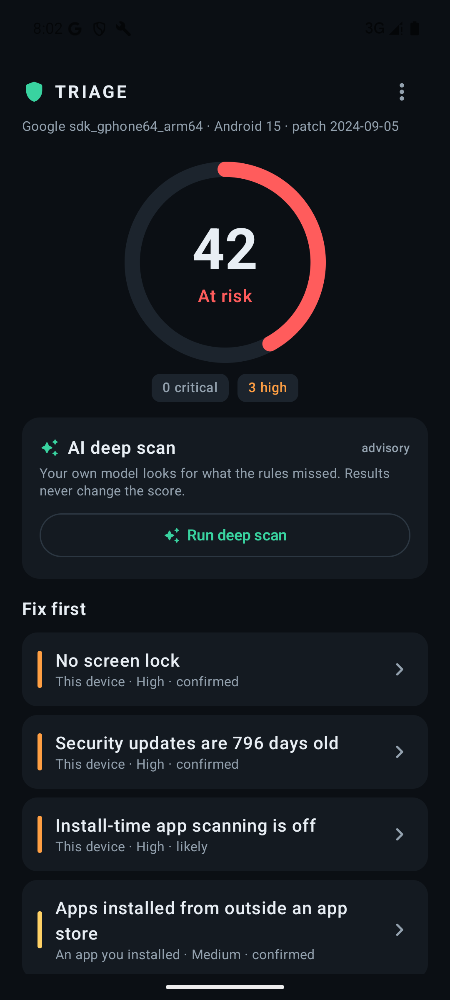
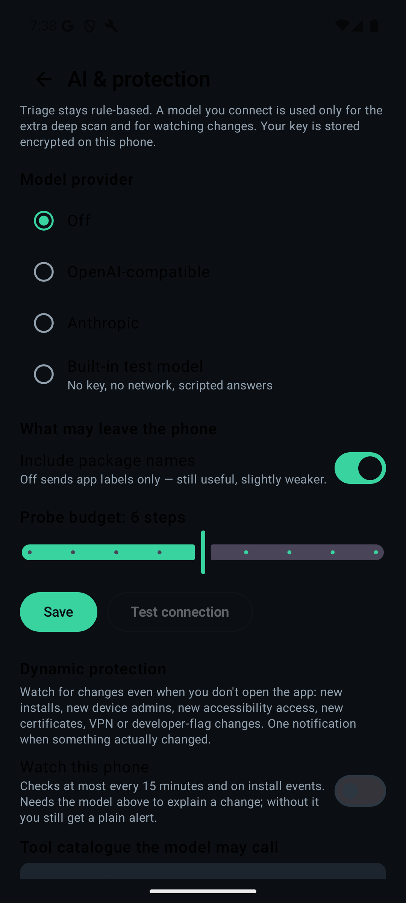

# Triage

A check-up for the phone in your hand.

| Report | AI deep scan | AI & protection |
| :---: | :---: | :---: |
|  |  |  |

Triage is a device-owner security app. It reads the phone locally and answers one
question honestly: **what on this device can reach my messages, my screen, my
accounts or my network — and what should I do about it?**

Built for Android first. The scoring/rules layer is platform-neutral so an iOS
companion can share it.

## Optional AI (bring your own key)

The rules are the product. On top of them you can connect **your own model** and use
two extra modes:

- **Deep scan** — a bounded, read-only agent loop over the evidence already on the
  phone (8 fixed tools, 2–10 steps, 6 findings max). Findings are labelled `AI` and
  never change the rule score.
- **Dynamic protection** — a baseline diff on new installs, device admins,
  accessibility access, certificates, VPN and developer flags. One notification when
  something actually changed; silent for routine installs.

Providers: any OpenAI-compatible endpoint (including a local server), Anthropic, or a
built-in offline test model. The key is stored encrypted on the device. Full design
in [docs/AI.md](docs/AI.md).

## Principles

1. **Owner-side, not enterprise-side.** No MDM, no admin console, no "ask your IT
   department". Every finding is something the person holding the phone can fix.
2. **Read-only.** No root, no exploits, no writes to other apps' data.
3. **No account, no upload by default.** The report stays on-device. AI is opt-in,
   bring-your-own-key, and sends only the evidence bundle.
4. **No scareware.** Severity is a fixed rubric, not a red badge for engagement.
   Every finding carries a confidence level and says when it is a guess.
5. **Fix is part of the finding.** A finding without a settings deep link and
   plain instructions is a bug.
6. **Say what it can't see.** A clean scan is "no known problem", not "proven
   clean".

## What it checks (v0.1)

25 deterministic checks across seven groups:

| Group | Examples |
|---|---|
| OS | security-patch age, end-of-life release, test-key build |
| Lock & storage | missing lock screen, swipe-only lock, encryption |
| Install posture | unknown sources, sideloaded apps, installer age, Play Protect verifier, obsolete target SDK |
| Monitoring apps | stalkerware fingerprints, new-and-overprivileged apps |
| **Published indicators** | **1,054 bundled spyware values: APK file hashes, signing certificates, package names** |
| Access surfaces | accessibility, device admin, notification access, overlay, usage access, SMS+screen combination |
| Network | user CA certificates, global proxy, Private DNS off, open/WEP Wi-Fi, active VPN |

See [docs/CHECKS.md](docs/CHECKS.md) for the signal and false-positive notes of
each one, and [docs/INDICATORS.md](docs/INDICATORS.md) for the indicator corpus,
its licence, and its staleness.

Every report also lists **what could not be checked** — the shell-only records
(intrusion logs, install history, Cellebrite traces) and anything the hash budget
skipped. A clean score is only as good as its gaps.

## What it does not do

- Detect a fresh, unknown spyware implant. Indicators only match samples somebody
  published, and the bundled corpus is a snapshot with an as-of date.
- Read app-private storage without root or a backup.
- Inspect traffic contents, or read system logs (needs a USB collection).
- Scan other devices on the network.
- Run on iOS below the profile/config layer (see [docs/ROADMAP.md](docs/ROADMAP.md)).

## Build

Requires JDK 17+, Android SDK 35.

```bash
./gradlew :app:assembleDebug
adb install -r app/build/outputs/apk/debug/app-debug.apk
```

Unit tests (rules are pure functions, no device needed):

```bash
./gradlew :app:testDebugUnitTest
```

Real-device test build (release packaging, debuggable, no R8):

```bash
./gradlew :app:assembleDeviceTest
adb install -r app/build/outputs/apk/deviceTest/app-deviceTest.apk
```

See [docs/TESTING.md](docs/TESTING.md) before the first phone run.

## Architecture

```
collector (Android, read-only)
        │  normalised Evidence + certificate/file fingerprints
        ▼
rule engine (pure Kotlin, 25 rules)      ← unit-tested, deterministic
        │  Finding[] + 0-100 score + gaps
        ▼
local report (app-private JSON)  ──share──▶ user / later: Artex
        │
        ▼
Compose UI: score → fix-first list → detail → settings intent
```

Details in [docs/ARCHITECTURE.md](docs/ARCHITECTURE.md).

## Relation to Artex

Artex is the heavy autonomous pentest system. Triage is the consumer layer in
front of the same idea. The deterministic engine ships on-device; the same
evidence bundle can later be handed to an Artex task (as an MCP/http tool source)
for explanation and deep-dive without giving Artex filesystem access to the
phone.

## Status

Working vertical slice: collector → rules → score → detail → deep link, indicator
matching, gaps reporting, training example, optional AI deep scan, change watching,
daily re-scan, boot scan, notification, and JSON export. 20 unit tests. Not yet
ship-ready: see the roadmap (permission declarations, Play data-safety form, copy
review, performance budget, corpus refresh workflow).

## Credits

Indicator data from the [Zero Breach Toolkit](https://github.com/interplains/Zero-Breach-Toolkit)
(CC0), itself built on research by Amnesty International's Security Lab, the Citizen
Lab, the MVT project, ESET, Cisco Talos, SentinelLabs, Meta, Volexity, Unit 42 and
Lookout. See [NOTICE](NOTICE).

## License

App code: MIT. Bundled indicator data: CC0 1.0. Stalkerware fingerprints are a
hand-maintained corpus, not a licensed feed.
